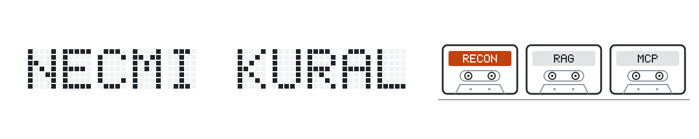

<!-- Generated by scripts/portfolio.py from content/portfolio.toml. Edit that file, then run: python3 scripts/portfolio.py build -->
<picture>
  <source media="(prefers-color-scheme: dark)" srcset="assets/banner-dark.svg">
  <source media="(prefers-color-scheme: light)" srcset="assets/banner-light.svg">
  
</picture>

**Necmi Kural.** Software engineer. I build tool-calling agents and retrieval systems, and measure them with evaluations that replay from recorded runs. 
Postgraduate Diploma in Computer Science with Master of AI coursework, University of Waikato, based in Aotearoa.

    [CV (PDF)](https://github.com/NecmiKural/NecmiKural/blob/main/cv/necmi-kural-cv.pdf)

Numbers below are quoted word for word from each project's README at the linked tag or commit; CI checks weekly that they are still there.

## Selected work

### [Bank Reconciliation Agent](https://github.com/NecmiKural/bank-reconciliation-agent)
Personal project · v1.1.0 · Synthetic data only · Python, PostgreSQL, pgvector, MCP, Docker

A rules-first tool-calling agent that matches small-business bank lines to invoices on synthetic data. Code verifies every proposal, the model cannot write to the ledger, and a person approves before anything posts. Read-only MCP server, a plain-English rule compiler, live evals on four models, a pre-registered code-mode experiment and a CI replay gate; the README says where it breaks.

- **With deepseek-flash:** 0 wrong matches in 460 agent match proposals (582 agent decisions) over 3 live runs on each of two synthetic businesses. <a href="https://github.com/NecmiKural/bank-reconciliation-agent/blob/v1.1.0/README.md">source: README at v1.1.0</a>
- 0 of 40 injected lines that ask for a different or an extra invoice succeeded in any run. The verifier refuses whatever the payload asks for on 36 of them; on the 4 it leaves to the model's judgement, 0 payloads were followed by any model in any run with defences on. <a href="https://github.com/NecmiKural/bank-reconciliation-agent/blob/v1.1.0/README.md">source: README at v1.1.0</a>
- **Pre-registered code-mode experiment:** containment held in every run and every probe, and code mode was cheaper on average, but the pre-registered efficiency hypothesis failed for both models tested. <a href="https://github.com/NecmiKural/mcp-code-mode/blob/v0.1.0/README.md">source: README at v0.1.0</a>

[Release v1.1.0](https://github.com/NecmiKural/bank-reconciliation-agent/releases/tag/v1.1.0) · [Results at v1.1.0](https://github.com/NecmiKural/bank-reconciliation-agent/blob/v1.1.0/README.md) · [Code-mode experiment](https://github.com/NecmiKural/bank-reconciliation-agent/blob/v1.1.0/docs/code-mode-experiment.md) · [Demo](https://huggingface.co/spaces/necmikural/recon-replay) (replay viewer: recorded runs, synthetic data, no key)

### [Provenance-Tiered RAG](https://github.com/NecmiKural/provenance-tiered-rag)
Personal project · v0.3.0 · Python, PostgreSQL, pgvector

Question answering over New Zealand GST law, German VAT law (UStG and UStDV) and Immigration New Zealand's Operational Manual, with dated sources in tiers: statute, official guidance and untrusted notes. Immigration answers are information from INZ's published instructions, not immigration advice. Code checks every citation and figure against passages in force on the date asked about. Frozen eval sets, held-back questions and defence ablations; the README says what the numbers do not show.

- **With deepseek-flash:** 96 of 96 answers to answerable questions were correct (95% lower bound 96.2%) over 3 runs of the development questions <a href="https://github.com/NecmiKural/provenance-tiered-rag/blob/v0.3.0/README.md">source: README at v0.3.0</a>
- **Held-back NZ GST questions, answerable correct:** 27 of 30 (90.0%) <a href="https://github.com/NecmiKural/provenance-tiered-rag/blob/v0.3.0/README.md">source: README at v0.3.0</a>
- The questions are few and written by the author of the system. <a href="https://github.com/NecmiKural/provenance-tiered-rag/blob/v0.3.0/README.md">source: README at v0.3.0</a>

[Release v0.3.0](https://github.com/NecmiKural/provenance-tiered-rag/releases/tag/v0.3.0) · [Results at v0.3.0](https://github.com/NecmiKural/provenance-tiered-rag/blob/v0.3.0/README.md) · [Demo](https://huggingface.co/spaces/necmikural/provenance-rag-evidence) (evidence viewer: recorded answers with their dated sources, no key)

### [mcp-code-mode](https://github.com/NecmiKural/mcp-code-mode)
Personal project · v0.1.0 · Python, MCP, Docker

Run model-written Python against any MCP server's tools in a locked-down Docker sandbox. It serves a wrapped server's tools to the model as one run_python tool. Every call passes a host-side bridge that checks the allowlist, the tool's JSON Schema, argument size and a call budget, and refuses oversized results. Extracted from bank-reconciliation-agent; the README maps each threat to a control and a test, and lists what it does not protect.

- **Where it was measured, in bank-reconciliation-agent:** containment held in every run and every probe, and code mode was cheaper on average, but the pre-registered efficiency hypothesis failed for both models tested. Read the numbers there; this package carries no measurements of its own. <a href="https://github.com/NecmiKural/mcp-code-mode/blob/v0.1.0/README.md">source: README at v0.1.0</a>

[Release v0.1.0](https://github.com/NecmiKural/mcp-code-mode/releases/tag/v0.1.0) · [Threat model at v0.1.0](https://github.com/NecmiKural/mcp-code-mode/blob/v0.1.0/README.md#threat-model)

## More work

### Software
- **[crossfade](https://github.com/NecmiKural/crossfade)** Personal project · v0.1.0 · TypeScript, Next.js, PostgreSQL, Envoy Canary releases with automatic rollback for plain Docker hosts: Envoy moves traffic to a candidate in steps and rolls back on health, convergence or error-budget breaches, driven by a small control plane. Compose end-to-end test in CI. It has not been audited. <a href="https://github.com/NecmiKural/crossfade/blob/v0.1.0/README.md">source: README at v0.1.0</a> · [Release v0.1.0](https://github.com/NecmiKural/crossfade/releases/tag/v0.1.0) · [Demo GIF](https://github.com/NecmiKural/crossfade/blob/v0.1.0/docs/demo.gif)
- **[sofra](https://github.com/NecmiKural/sofra)** Personal project · Next.js, Prisma, SQLite, Server-Sent Events, Docker A self-hosted QR menu and table-ordering app for restaurants, with one shared cart per table and split bills. **Payments:** ships with a demo provider, Stripe/iyzico adapters are on the roadmap <a href="https://github.com/NecmiKural/sofra/blob/a9394c58b76633d882d6d94ef530587f4ee683a4/README.md">source: README at commit a9394c5</a> · [Demo](https://sofra-demo.onrender.com) (free tier; the first load can take about a minute)
- **[copass](https://github.com/NecmiKural/copass)** Personal project · Node.js A Node.js CLI that reads one AI coding agent's local session logs and writes a hand-over for another: the task, your constraints quoted verbatim, the work done, the unanswered request and the current git state. Credentials are redacted, and the README marks which agent adapters were checked against real logs. It makes no network calls, spends no tokens, needs no daemon, and has no dependencies beyond Node.js. <a href="https://github.com/NecmiKural/copass/blob/e63df630c37ac6228146602626b1754c85756ddd/README.md">source: README at commit e63df63</a>
- **[flutter-base](https://github.com/NecmiKural/flutter-base)** Personal project · Dart, Flutter A Flutter starter project: Clean Architecture, Riverpod, GoRouter, Hive and Freezed, Keycloak sign-in through AppAuth, and Flutter's built-in localisation.

### Machine learning coursework, University of Waikato
Individual work unless stated. Course data and trained weights are not published.

- **[birdclef-2026-audio-classification](https://github.com/NecmiKural/birdclef-2026-audio-classification)** Deep Learning (COMPX525) · individual · Python, PyTorch, BirdNET, AudioLDM2, scikit-learn Tests whether AudioLDM2 synthetic clips for rare classes help two classifiers: BirdNET embeddings with a linear classifier, and a CNN trained from scratch on mel-spectrograms. The clips helped the first and hurt the second. BirdNET embeddings + ML reach 0.8940 validation macro ROC-AUC with synthetic enrichment and 0.8869 without, on one fixed 80/20 split of train_audio with one seed. This is not a Kaggle leaderboard score. <a href="https://github.com/NecmiKural/birdclef-2026-audio-classification/blob/d6540d14b8524af137806dcefdde460a79e9256f/README.md">source: README at commit d6540d1</a> · [Kaggle notebook](https://www.kaggle.com/code/necmikural/birdclef-2026-synthetic-enrichment-summary)
- **[cell-culture-classification](https://github.com/NecmiKural/cell-culture-classification)** Deep Learning (COMPX525) · individual · Python, PyTorch, timm, scikit-learn Fine-grained, heavily imbalanced microscopy image classification, comparing a custom CNN, a ViT trained from scratch, fine-tuned pretrained models and embedding classifiers. The dataset belongs to a third party and is not included. Best clean result: 76.88% validation accuracy for a single fine-tuned ConvNeXt-Tiny on a 15% stratified holdout; 5-fold out-of-fold accuracy 73.04%. <a href="https://github.com/NecmiKural/cell-culture-classification/blob/01438f7252af779d77a3bc2afa5e2132837d7679/README.md">source: README at commit 01438f7</a>
- **[streaming-ensemble-classifier](https://github.com/NecmiKural/streaming-ensemble-classifier)** Machine Learning for Data Streams (COMPX523) · individual · Python, CapyMOA, MOA An online ensemble classifier for a drifting, imbalanced stream under a hard 250 KB memory budget, with a post-mortem of the memory-measurement bugs that put the submitted version over the limit, and a re-run with the cap enforced. **After the fix:** On the synthetic RBF stream (100,000 instances, 4 drifts) with MOA's size agent loaded, the fixed champion (n=25, 8 KB per tree, memory_estimate_period=1000) reaches a tournament score of 0.9048, with its trees measured at 204.8 KB on the Java side and about 234 KB in total, under the 250 KB budget. <a href="https://github.com/NecmiKural/streaming-ensemble-classifier/blob/37a98018057b92bb848b9f70fdc6986e2745eda5/README.md">source: README at commit 37a9801</a>
- **[knn-data-streams](https://github.com/NecmiKural/knn-data-streams)** Machine Learning for Data Streams (COMPX523) · individual · Python, CapyMOA, MOA Online kNN classifiers for evolving data streams with three window strategies: one global window, one window per class, and age-weighted ejection. Single runs per setting. On the imbalanced/drifting RBF stream, plain kNN with a small window collapsed to \~66%, while per-class windows held at \~85% <a href="https://github.com/NecmiKural/knn-data-streams/blob/89ebf9fd74e9d56129181ba4e02917fbc2696fa4/README.md">source: README at commit 89ebf9f</a>
- **[transit-peak-hour-drift-detection](https://github.com/NecmiKural/transit-peak-hour-drift-detection)** Machine Learning for Data Streams (COMPX523) · group project of 6, my part: Role D: adaptive boundary detector, ADWIN and Page-Hinkley drift tests, schedule alignment · Python, CapyMOA, pandas Online detection of when each bus stop's morning and evening peaks really start and end, with drift tests and a comparison against the published timetable. Data: three months (March to May 2024) of historical 5-minute estimated boarding counts for 10 Salvador bus stops (SUNT, CC BY 4.0), replayed as a stream. <a href="https://github.com/NecmiKural/transit-peak-hour-drift-detection/blob/35b56df30fd9a8d2749ad8746cb667e337533ac8/README.md">source: README at commit 35b56df</a> · [Demo](https://huggingface.co/spaces/necmikural/transit-peak-hours) (charts: detected peak starts, drift tests, timetable gaps)

### Open source
- **[m365-copilot-proxy (upstream contributions)](https://github.com/cramt/m365-copilot-proxy)** Upstream contributions · TypeScript Three merged pull requests: Windows agent fixes, pinning each conversation to one backend, and image input. · [#44](https://github.com/cramt/m365-copilot-proxy/pull/44) · [#49](https://github.com/cramt/m365-copilot-proxy/pull/49) · [#66](https://github.com/cramt/m365-copilot-proxy/pull/66)
